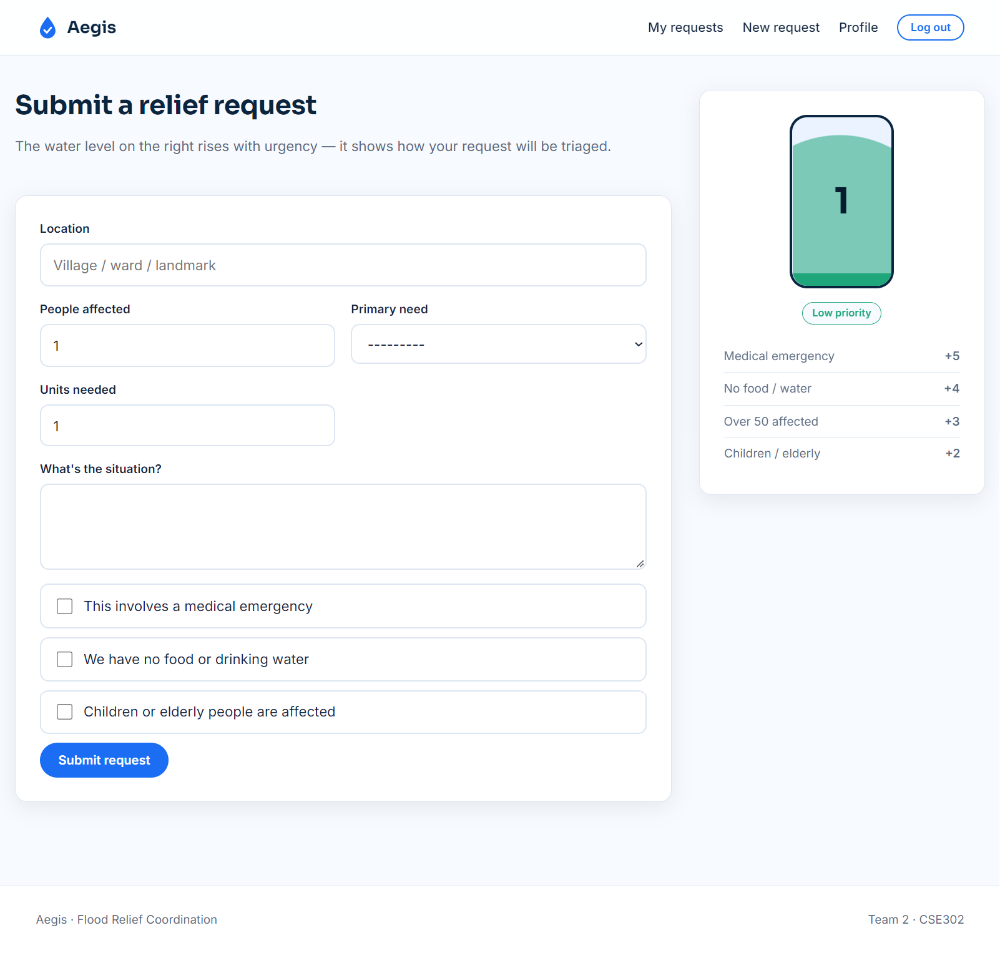
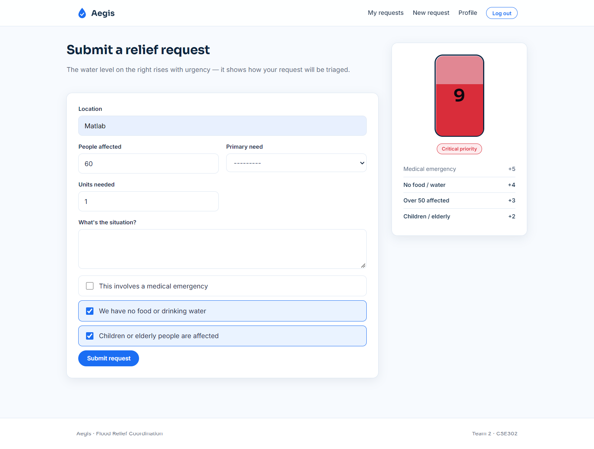
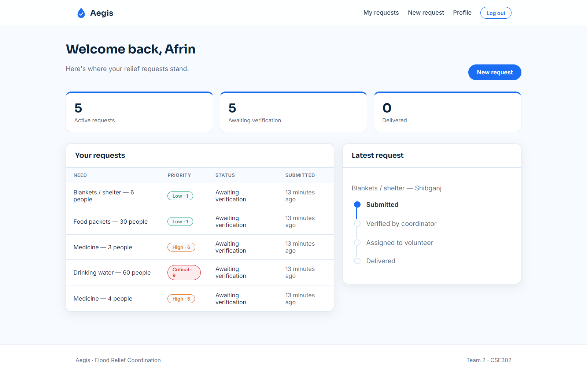

# Priority Scoring (Relief Requests)

Owner: Member 2 (Sadia). Code: `reliefrequests/scoring.py`, mirrored in the browser by `static/js/gauge.js`.

## What it does
Every relief request gets a **priority score** the moment it is saved. The score decides how fast the request is handled.
The family never types the score; `ReliefRequest.save()` calls `calculate_priority()` automatically.

## Rules
| Condition | Points |
|---|---|
| Medical emergency | +5 |
| No food or drinking water at hand | +4 |
| More than 50 people affected | +3 |
| Children or elderly present | +2 |
| None of the above (normal request) | 1 (baseline) |

Scores add up. The maximum is 14.

## Severity bands
| Score | Band |
|---|---|
| 8 or more | Critical |
| 5 to 7 | High |
| 3 to 4 | Medium |
| 1 to 2 | Low |

## Worked examples
| Request | Calculation | Result |
|---|---|---|
| 60 people, no water, children present | 4 + 3 + 2 | 9 - Critical |
| Medical emergency only | 5 | 5 - High |
| 51 people, nothing else | 3 | 3 - Medium |
| 50 people, nothing else (50 is not "more than 50") | baseline | 1 - Low |

## Pages built for this feature
- **Submit a request** (`/requests/new/`): form with a live water-level gauge that shows the score while you fill it in.
- **My requests** (`/requests/mine/`): the family's own requests, their priority badge, status and a progress timeline.

## How to run the tests
```
python manage.py test reliefrequests
```

## Test results
All tests for this module pass (scoring rules, band edges, automatic priority on save, ordering,
submission by a family, rejection of invalid input, role protection and "only my own requests").

## Screenshots



